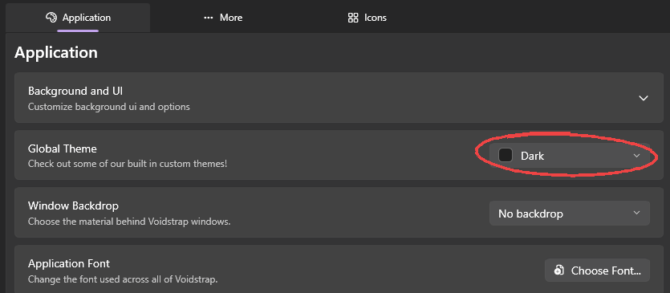

## App theme

Pick a built in theme (Dark, Light, Voidstrap, Berry, Blue and others) or make your own in the **Theme Creator**: recolour any part of the app, add a gradient and save it as a profile. You can also use your Windows accent colour.

## Background

Use any image or video as the app background, with a gradient and a dark shade on top so text stays readable. Show it on the home page only or on every window.

## Fonts and backdrop

Change the app font and, on Windows 11, the window backdrop material.

## Sidebar

Rename, reorder, hide or re-icon any sidebar page. Home and Appearance always stay so you can never lock yourself out.

## Launcher style

Choose how the window looks while Roblox starts: classic styles, or a **Custom** launcher you build in the editor with XML or HTML. The preview shows a fake install so you can admire it without waiting for an update.

## Language

Voidstrap is available in 90+ languages. **Auto translate** translates the whole app on the fly, and turning it off puts the original text back instantly.
