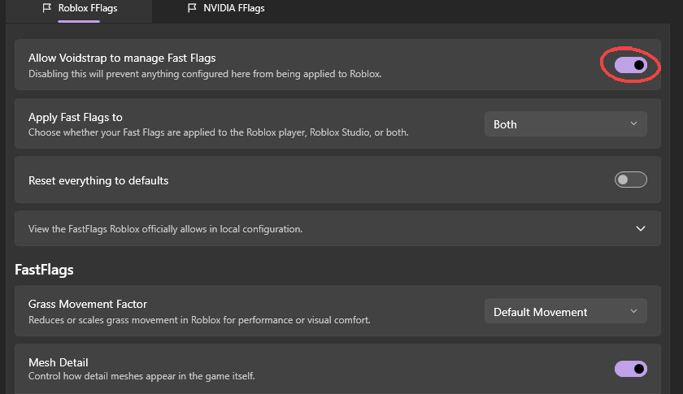

FastFlags are Roblox's internal switches. Roblox only reads a small **allowlist** of them from local files, and ignores everything else. So this page only covers flags on that list, because the rest simply do nothing, no matter how cool the forum post made them sound.

## Turning it on

On **FastFlag Settings**, keep **Allow Voidstrap to manage Fast Flags** on. **Apply Fast Flags to** picks the Roblox player, Roblox Studio, or both. Changes apply on the next Roblox launch.

## The allowlist

Voidstrap reads the current list straight from Roblox, so it is always up to date. At the time of writing it is:

### Rendering API

| Flag | What it does |
| --- | --- |
| `FFlagDebugGraphicsPreferD3D11` | Prefer Direct3D 11 |
| `FFlagDebugGraphicsPreferVulkan` | Prefer Vulkan |
| `FFlagDebugGraphicsPreferOpenGL` | Prefer OpenGL |

### Quality

| Flag | What it does |
| --- | --- |
| `DFIntDebugFRMQualityLevelOverride` | Forces the graphics quality level |
| `DFFlagTextureQualityOverrideEnabled` | Turns on the texture quality override |
| `DFIntTextureQualityOverride` | Texture quality to force |
| `FIntDebugForceMSAASamples` | Anti-aliasing (MSAA) samples |
| `DFFlagDisableDPIScale` | Keeps render quality on scaled displays |

### Grass and sky

| Flag | What it does |
| --- | --- |
| `FIntFRMMinGrassDistance` | Closest distance grass is drawn |
| `FIntFRMMaxGrassDistance` | Farthest distance grass is drawn |
| `FIntGrassMovementReducedMotionFactor` | How much grass sways |
| `FFlagDebugSkyGray` | Plain gray sky |

### Geometry

| Flag | What it does |
| --- | --- |
| `DFIntCSGLevelOfDetailSwitchingDistance` | Base distance for mesh detail switching |
| `DFIntCSGLevelOfDetailSwitchingDistanceL12` | Detail level 1 to 2 distance |
| `DFIntCSGLevelOfDetailSwitchingDistanceL23` | Detail level 2 to 3 distance |
| `DFIntCSGLevelOfDetailSwitchingDistanceL34` | Detail level 3 to 4 distance |
| `DFFlagDebugPauseVoxelizer` | Pauses the voxel lighting update |

### Window

| Flag | What it does |
| --- | --- |
| `FFlagHandleAltEnterFullscreenManually` | Changes how Alt and Enter toggles fullscreen |

Roblox can change this list at any time. Voidstrap marks every flag as allowed or not, so you can always check.

:::tip
Want more FPS? The FPS flag is not on the allowlist. Use Roblox's own framerate cap in **Roblox settings** instead.
:::

## FastFlag editor

**FastFlag Editor** lets you add, edit, import and export allowlisted flags as JSON.

## Roblox settings

The **Global settings** editor changes Roblox's own settings file: framerate cap, graphics quality, mouse sensitivity, volume and fullscreen. These are real Roblox settings, so they always apply.

## Something broke

Turn on **Reset everything to defaults**, or delete the flag you just added and relaunch. Nine times out of ten, it is the flag from five minutes ago.
