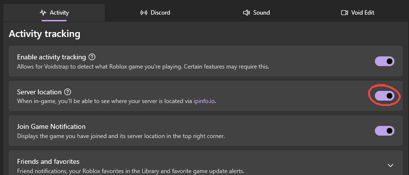

## Activity tracking

Voidstrap reads Roblox's log file to know which game and server you are in. Nothing is injected into Roblox. Discord activity, the server readout, game history and the matchmaker all build on this.

## Discord Rich Presence

Shows the game you are playing on your Discord profile, with its icon, how long you have played and a join button if you allow it. When you are not in game it shows Voidstrap instead. Studio sessions show the place and the script you are editing.

If your status does not show, check that Discord's own **Share my activity** setting is on. It is always that setting. Always.

## Server location

Shows where your server is when you join, using [ipinfo.io](https://ipinfo.io).

## Snap Tap

When you press two opposite keys like A and D, the latest one wins instead of cancelling out. Handy for strafing.

## Audio

- **Background volume**: lowers Roblox while it is not focused.
- **Output device**: send Roblox audio to a specific device.
- **Equalizer** (Linux): shapes only Roblox's sound through a PipeWire filter.

## Network

- **MTU**: limits packet size for all apps. Needs admin, stays after restart, and may not improve ping. It is a dial, not a magic button.

## Desktop app and more

Other switches here include game icons in the title bar, the desktop app behaviour and screenshot notifications.
