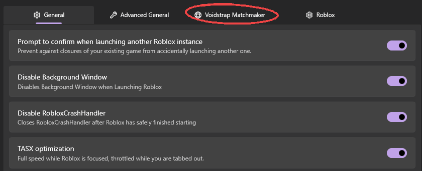

The Server Matchmaker picks the Roblox server closest to you instead of letting Roblox choose. It powers Smart Join on game pages and launches from Voidstrap.

## How it picks a server

1. It lists the game's public servers.
2. For each candidate, it asks Roblox which datacenter the server is in.
3. It compares each datacenter with your approximate location.
4. It joins the closest server with room.

If Roblox does not reveal server locations, or every server is far away, Roblox chooses as normal. The whole search is time limited so a join never hangs.

## Datacenters

The datacenter map shows every active Roblox datacenter. Click a pin to pick one, drag to pan, scroll to zoom.

- **Preferred datacenter**: always tried first. Voidstrap falls back only when it has no room.
- **Blocked datacenters**: never placed there. If Roblox puts you in one, Voidstrap moves you out.

## Per game rules

Search a game by name or paste its place ID to exclude it, or allow it again. Games that run their own matchmaking, such as lobbies that teleport you, belong in the excluded list.

## Better servers after joining

When a better server is found after you join, Voidstrap can ask first. If you do not answer within 20 seconds, you stay. A reconnect limit stops it after a set number of moves so it never loops.

## Server browser

The in game server browser lists servers ranked by ping.

| Message | Meaning |
| --- | --- |
| Join a game before opening the server browser | It only works in game. |
| Server listing is paused | Roblox is rate limiting. Wait a moment. |
| Your location could not be found | Servers cannot be ranked by ping. |
| Roblox did not reveal where any of these servers are | Try again shortly. |
| Every server found is in a datacenter you blocked | Unblock one or let Roblox choose. |

## Join endpoint

Advanced settings can change the Roblox join endpoint used to locate servers. Only change it if joins stop working.
