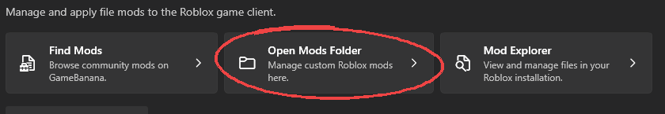
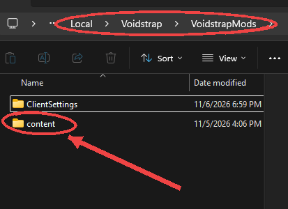
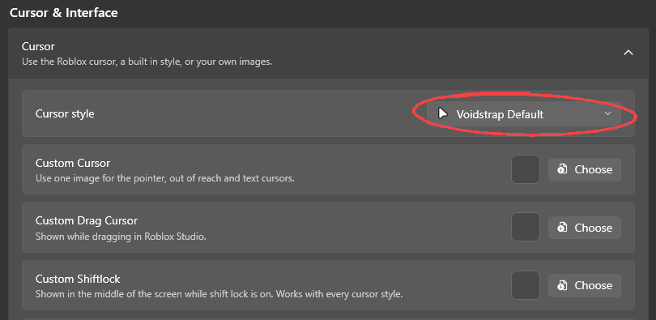
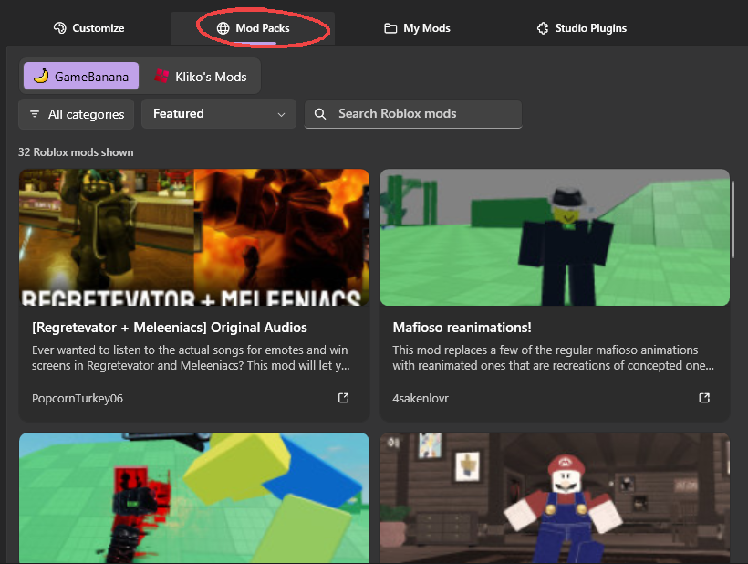

import { Steps, FileTree, Aside } from '@astrojs/starlight/components';

Mods swap files inside Roblox for your own: the oof sound, the cursor, fonts, skyboxes and more. Everything is local and cosmetic. Other players still hear their own oof, so no, you cannot make the whole server suffer your airhorn.

## How it works

Voidstrap keeps your mods in a folder of their own, so Roblox updates never wipe them. Every time Roblox launches, that folder is copied on top of the Roblox install.

| What | Where (Windows) |
| --- | --- |
| Your mods | `%LocalAppData%\Voidstrap\VoidstrapMods\` |
| Roblox install | `%LocalAppData%\Voidstrap\RblxVersions\version-<id>\` |

Open the mods folder any time with **Mods**, **Open Mods Folder**.

 It starts out holding only `ClientSettings`, which is where your FastFlags live. Leave that one alone.

## Built in mods

You do not need any files for the common stuff. The **Mods** page has switches for:

- **Cursors**: pick a cursor or a full cursor set, including the classic arrow from 2006 and 2013.
- **Death sound**: pick a preset or use your own `.ogg`, `.mp3` or `.wav`.
- **Custom font**: use any `.ttf` or `.otf` for the whole game.
- **Skybox**: replace the default sky.
- **Classic topbar** and other interface tweaks.
- **Mod generator**: recolours Roblox's interface with your own colours, gradients and icon swaps, then builds the mod for you.

## Installing a downloaded mod

<Steps>

1. Open the downloaded `.zip`.
2. Find the folders called `content`, `ExtraContent` or `PlatformContent`.
3. Drag them into your `VoidstrapMods` folder. Say yes if Windows asks to merge folders.
4. Close Roblox fully and launch again.

</Steps>

Want a few mods at once? Extract them all into the same folder. If two mods replace the same file, the last one you copied wins. That is not a bug, that is just how files work.

<Aside type="caution">
Only install mods from people you trust. A mod pack is just files, but a weird `.exe` inside one is not a mod, it is a problem.
</Aside>

## Making your own mod

<Steps>

1. Find the file you want to replace in the Roblox install folder.
2. Make your edited version with the **same name**.
3. Put it in `VoidstrapMods` at the **same path** it had inside the Roblox folder.
4. Relaunch Roblox.

</Steps>

For example, to replace the oof sound:

<FileTree>

- VoidstrapMods
  - ClientSettings
  - content
    - sounds
      - ouch.ogg

</FileTree>

### Useful paths

| What | Path |
| --- | --- |
| Mouse cursors | `content\textures\Cursors\KeyboardMouse\` |
| Character sounds | `content\sounds\` |
| Fonts | `content\fonts\` |
| Avatar editor background | `ExtraContent\places\Mobile.rbxl` |
| Surface textures | `PlatformContent\pc\textures\` |
| Sky | `PlatformContent\pc\textures\sky\` |

Most interface icons are packed together into sprite sheets, so swapping a single icon is painful. The mod generator handles the common icon swaps for you.

## Removing mods

Delete the files you no longer want from `VoidstrapMods` and relaunch. Voidstrap puts the original Roblox files back on the next launch. Turning off a built in mod on the **Mods** page works the same way.

## Sharing a mod

<Steps>

1. Move everything except your mod's files out of `VoidstrapMods` for a moment, including `ClientSettings`.
2. Select the folders inside `VoidstrapMods` (not the folder itself) and zip them, so `content` sits at the top of the zip.
3. Give the zip a nice name and move your other files back.

</Steps>

## Community mods

The **Community mods** tab lists mod packs from other players. Each one credits its author. Install with one click, remove with one click, and no zip juggling at all.

## Linux and macOS

Mods work the same on every platform. On Linux, Voidstrap maps the files into Sober's Android package layout for you, so the same mod folders work. See [Linux](/platforms/linux/).

## Not the same as Voidstrap mods

These mods change **Roblox**. Add-ons that change the **Voidstrap app** itself are a different thing, covered in [Voidstrap mods](/features/voidstrap-mods/).
