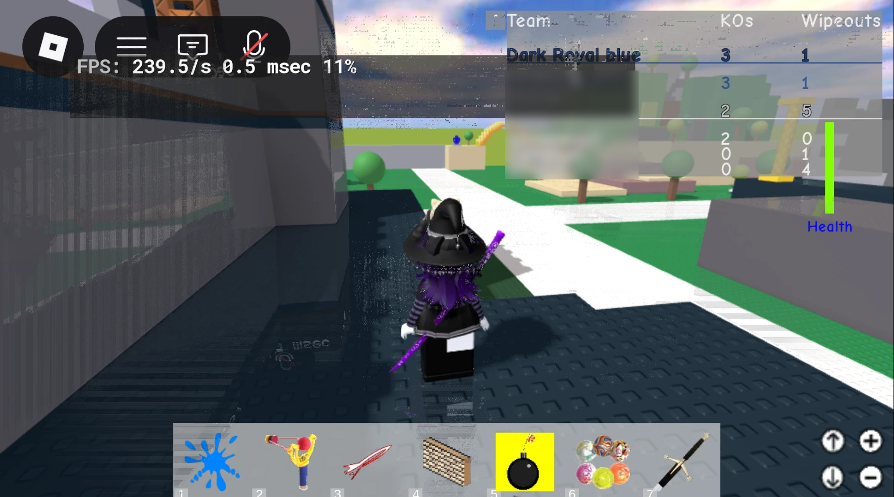

## RiShade

:::caution[Being rebuilt]
RiShade is being redone from scratch. It is actively being built and is not finished yet. Expect glitches, and expect this page to change.
:::

RiShade adds depth based effects like fog and depth of field to Roblox through ReShade. Those effects need to know how far away everything is, and that is the hard part.

### Why an emulator

Getting depth out of the normal Windows version of Roblox means attaching to the Roblox process, and Roblox's anti-tamper protection blocks that. Pushing past it could risk a ban, so RiShade does not go there.

Instead, RiShade runs the Android version of Roblox inside **Smoothie**, an Android emulator built for this project. The depth information comes from the emulator's graphics, so nothing ever touches the Roblox process. And no, this is not "native Android on Windows". It is an emulator, glitches and all.

### Is it safe?

Nothing attaches to Roblox, which is why this route was picked. How Roblox treats emulators under its terms of service is still being checked, and RiShade will only ship once it is confirmed to be safe.

### Linux

On Linux, Voidstrap already runs Roblox through Sober, which uses the Android version. The same kind of integration should be easier and faster there than on Windows.

### Credits

Huge thanks to Squire Dot, who is the main reason any of this works right now.

## Video Clipper

Records your gameplay in the background so you can save the last moments after something great happens. Pick quality, length and the save folder.

## Void Edit

A video editor built into Voidstrap. With **Open recordings in Void Edit** on, Voidstrap asks after you leave a game whether to open your new recordings as projects.
